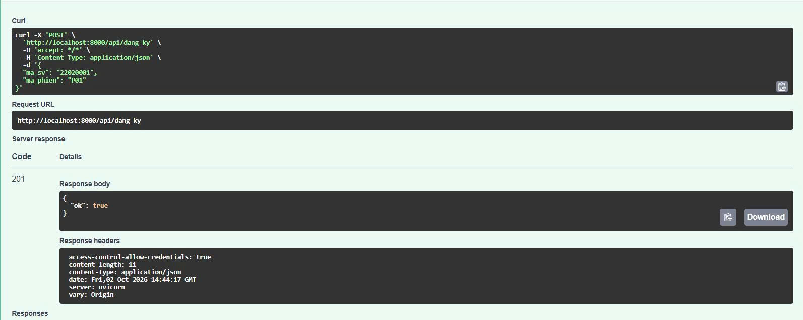
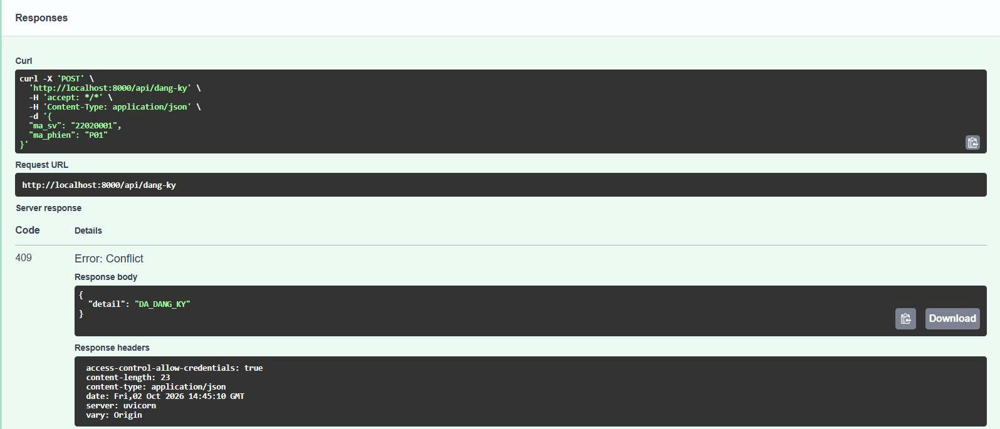
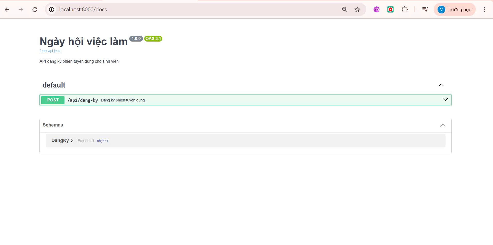
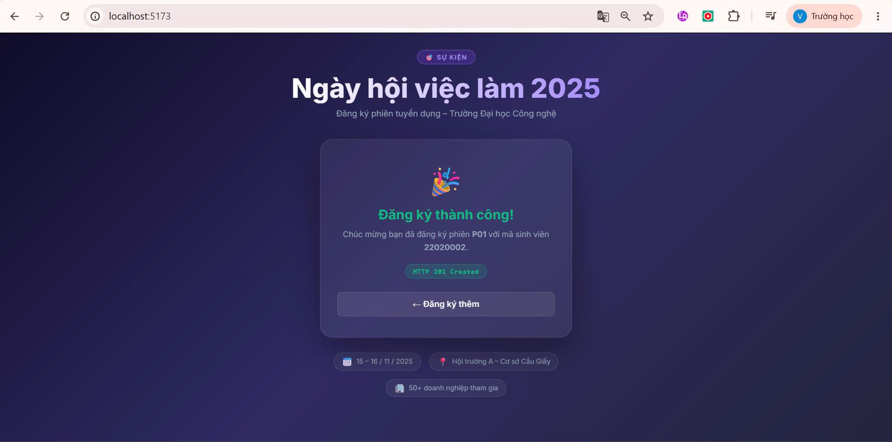

# Báo cáo Bài tập Tuần 3 – Cổng đăng ký Ngày hội việc làm

## Thông tin sinh viên
| Mục | Thông tin |
|-----|-----------|
| Họ và tên | *BÙI XUÂN VINH* |
| Mã sinh viên | *23110232* |
| Lớp | *BCSE2023* |
| Ngày nộp | 02/10/2025 |

---

## 1. Mục tiêu bài tập
Dựng cổng đăng ký "Ngày hội việc làm" bao gồm:
- **Backend**: FastAPI + SQLite, trả về đúng mã HTTP (201 / 409 / 422)
- **Frontend**: Vite + React, giao diện đủ 3 trạng thái
- **Kết nối**: Frontend gọi API qua `fetch`, cấu hình CORS chặt chẽ

---

## 2. Các bước thực hiện

### 2.1 Tạo và kích hoạt môi trường ảo
```powershell
# Tạo venv
python -m venv .venv

# Kích hoạt (Windows PowerShell)
.venv\Scripts\Activate.ps1

# Cài thư viện
pip install fastapi uvicorn
```

### 2.2 Chạy máy chủ FastAPI
```powershell
uvicorn main:app --reload
```
Truy cập tài liệu API: http://localhost:8000/docs

### 2.3 Thử API trên /docs
- Gửi `POST /api/dang-ky` với `{ "ma_sv": "22020001", "ma_phien": "P01" }`
- **Lần 1**: nhận **201 Created** – `{"ok": true}`
- **Lần 2** (cùng dữ liệu): nhận **409 Conflict** – `{"detail": "DA_DANG_KY"}`

**Lần 1 – 201 Created:**


**Lần 2 – 409 Conflict:**


### 2.4 Chạy giao diện frontend
```powershell
cd ui
npm install
npm run dev
```
Truy cập: http://localhost:5173

### 2.5 Kết nối API – CORS
- Frontend gọi `fetch("http://localhost:8000/api/dang-ky", ...)`
- Backend cấu hình `allow_origins=["http://localhost:5173"]` *(chỉ một địa chỉ, không dùng `"*"`)*

---

## 3. Sản phẩm

### 3.1 Cấu trúc thư mục
```
week3/
├── backend/
│   ├── .venv/
│   ├── main.py
│   └── ngayhoi.db
├── ui/
│   └── src/
│       ├── App.jsx
│       ├── App.css
│       └── main.jsx
├── sodo.md
└── Report.md
```

### 3.2 Ảnh minh hoạ /docs



### 3.3 Ảnh giao diện – 3 trạng thái
 




## 4. Kỹ thuật đã áp dụng

| Kỹ thuật | Mô tả |
|----------|-------|
| **Pydantic model** | Tự động kiểm tra dữ liệu đầu vào, trả 422 nếu thiếu trường |
| **SQLite UNIQUE constraint** | `UNIQUE(ma_sv, ma_phien)` – ngăn đăng ký trùng |
| **IntegrityError → 409** | Bắt ngoại lệ `sqlite3.IntegrityError` để trả đúng mã HTTP |
| **CORS restrictive** | Chỉ cho phép đúng `http://localhost:5173` |
| **React state machine** | 5 trạng thái UI: idle / loading / success / conflict / error |
| **fetch API** | Gọi backend không cần thư viện ngoài |

---

## 5. Lỗi đã gặp và cách xử lý

| Lỗi | Nguyên nhân | Cách xử lý |
|-----|-------------|------------|
| Lần 2 vẫn trả 201 | File `ngayhoi.db` cũ chưa có UNIQUE | Xoá `ngayhoi.db`, chạy lại server |
| CORS error trên browser | `allow_origins` thiếu địa chỉ frontend | Thêm `http://localhost:5173` |
| 422 khi gửi | Tên trường không khớp (camelCase vs snake_case) | Sửa thành `ma_sv`, `ma_phien` |

---

## 6. Tự đánh giá

- [v] `main.py` chạy được, endpoint đúng
- [v] Lần 2 trả **409 Conflict**
- [v] Giao diện đủ **3 trạng thái**
- [v] `allow_origins` chỉ có **1 địa chỉ** (không dùng `"*"`)
- [v] `sodo.md` khớp với mã nguồn
- [v]  và 
